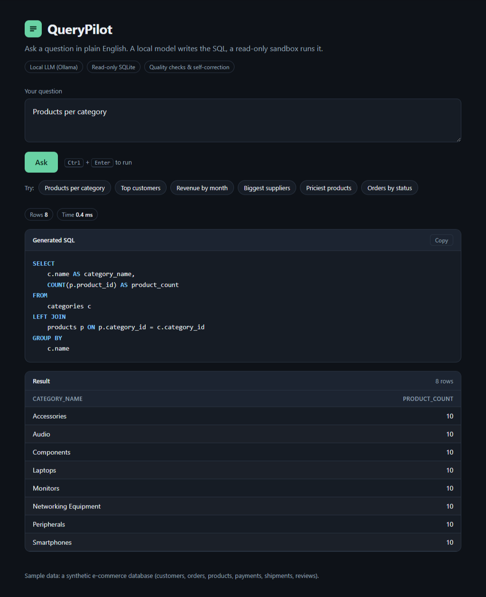

# QueryPilot

[](https://github.com/JyuViole-Grace/QueryPilot/actions/workflows/ci.yml)

**A local-first Text-to-SQL AI agent for SQLite, built around schema
grounding, guarded execution, validation, and bounded self-correction.**

QueryPilot translates natural-language questions into SQL, executes the
generated query against a synthetic e-commerce database, checks the
query and its result, and can request a corrected query when validation
identifies a problem. The default LLM runs locally through
[Ollama](https://ollama.com/).

The project is designed as an AI Engineer portfolio project. It
demonstrates an end-to-end Text-to-SQL workflow rather than SQL
generation alone: database context preparation, model interaction,
read-only execution, quality checks, repair feedback, evaluation, and
reporting.

> **Evaluation snapshot (read the caveats):** `qwen2.5:7b` reaches
> **83% Execution Match (83/100, 95% CI 74-89%)** on `heldout_v4`, a
> 100-question set with a frozen configuration (an earlier clean run on the
> Russian-language edition of the sample data gave 86%; same questions and
> numbers, different text, difference within noise). The set was written
> by an AI assistant with explicit, unambiguous wording, so this is a measure
> on tidy questions, not general Text-to-SQL accuracy. On the messier
> 30-question development set `heldout_v3` the same model scores 57%
> (17/30, CI 39-73%) on the English data. A 14B model gave no measurable
> gain on `heldout_v3` (measured on the Russian edition). See [Benchmark status](docs/EVALUATION.md#benchmark-status).

Documentation: [evaluation and experiments](docs/EVALUATION.md) |
[changelog](CHANGELOG.md)



## Features

-   **Natural language to SQL:** converts English questions into SQLite
    queries using a locally hosted Ollama model.
-   **Schema and value grounding:** supplies relevant database structure
    and contextual values to the generator.
-   **Bounded self-correction:** can regenerate SQL using execution
    errors and independent quality-validator feedback, with a
    configurable retry limit.
-   **Read-only SQL execution:** restricts execution to read queries and
    applies SQLite safety controls (read-only connection, authorizer
    allow-list, deny-lists for `sqlite_*` tables and memory-bomb functions,
    timeout, row and string limits).
-   **SQL quality validation:** checks generated queries for issues
    beyond basic SQL syntax and execution.
-   **FastAPI and browser interface:** exposes the query workflow
    through an API and a lightweight local web UI.
-   **Join-key guard:** `scripts/join_check.py` reads the foreign keys from
    `sql/schema.sql` and rejects conditions that equate different key
    columns (for example `c.category_id = a.product_id`). It is
    schema-derived and independent of any benchmark question. On the saved
    runs it flagged 0 correct answers and 0 of 90 reference queries, and
    caught 2 of the 8 wrong answers of the v6 run.
-   **Evaluation tooling:** supports reference-query validation, model
    evaluation, multiple result metrics, report comparison, and JSON
    reports.
-   **Checkpointed evaluation:** writes intermediate evaluation reports
    during a full run so completed question results are not lost if a
    later question or summary step fails.
-   **Local-first model execution:** the default setup uses Ollama; a
    hosted LLM API is not required.

## Architecture

### Runtime query flow

``` text
User question
     |
     v
Schema and value grounding
     |
     v
Ollama Text-to-SQL generation
     |
     v
SQL safety validation
     |
     v
Read-only SQLite execution
     |
     v
SQL/result quality validation
     |
     +---- acceptable --------------------> Response to user
     |
     +---- execution/quality issue -------> Feedback to model
                                               |
                                               v
                                        Bounded regeneration
                                               |
                                               v
                                        Re-validation
```

The repair loop is bounded. Quality feedback is based on the user
question, generated SQL, execution outcome, and independent
quality-validator findings. It is not intended to use the benchmark's
reference result during a normal repair cycle.

### Evaluation flow

``` text
Development / golden questions
              |
              v
      Reference SQL checks
              |
              v
      Development iteration

Fresh held-out questions
              |
              v
       Model evaluation
              |
              +---- first-pass metrics
              |
              +---- post-repair metrics
              |
              v
       JSON report + summary
```

Development datasets and held-out evaluation datasets serve different
purposes. Held-out questions should not be used to tune prompts,
validators, or benchmark-specific repairs if the resulting score is to
be presented as an independent evaluation.

## Technology

-   **Language:** Python
-   **LLM runtime:** Ollama
-   **Default model:** `qwen2.5:7b`
-   **Database:** SQLite
-   **API:** FastAPI
-   **Interface:** HTML/CSS/JavaScript browser UI
-   **Testing:** pytest
-   **Evaluation:** custom Python evaluation pipeline with JSON reports

## Database

QueryPilot uses a reproducible synthetic e-commerce database with 10
tables:

| Table | Purpose |
| ----- | ------- |
| `customers` | Customer records and registration details |
| `categories` | Product categories |
| `suppliers` | Product suppliers |
| `products` | Product catalog, prices, stock, and supplier/category relations |
| `coupons` | Discount coupon definitions |
| `orders` | Customer orders, dates, statuses, and discounts |
| `order_items` | Products and quantities within orders |
| `payments` | Payment records and statuses |
| `shipments` | Shipment records and carriers |
| `reviews` | Customer product reviews and ratings |

The database is initialized from `sql/schema.sql` and populated by
`scripts/seed_data.py` (fixed random seed, so the database is exactly
reproducible). The seed data is synthetic, English-language (Ukrainian city
names, transliterated customer names) and does not contain real customer
records.

## Quick start

### Requirements

-   Python 3.11 or newer (the SQL safety layer relies on
    `sqlite3.Connection.setlimit`); tested on Python 3.14 with sqlglot 30.26
-   [Ollama](https://ollama.com/)
-   Git (recommended)

### 1. Clone the repository and create an environment

``` bash
git clone https://github.com/JyuViole-Grace/QueryPilot.git
cd QueryPilot

python -m venv .venv
```

Activate the environment.

**Windows PowerShell**

``` powershell
.\.venv\Scripts\Activate.ps1
```

**Linux / macOS**

``` bash
source .venv/bin/activate
```

Install dependencies:

``` bash
python -m pip install -r requirements-dev.txt
```

### 2. Prepare the database

``` bash
python scripts/init_db.py
python scripts/seed_data.py
python scripts/validate_db.py
```

### 3. Start Ollama

Pull the default model if it is not already installed:

``` bash
ollama pull qwen2.5:7b
```

Make sure the Ollama service is running and the model is available:

``` bash
ollama list
```

### 4. Start the application

``` bash
uvicorn app.main:app --reload
```

Open the local interface (the API has **no authentication**; keep it on
localhost):

-   **Web UI:** http://localhost:8000
-   **OpenAPI documentation:** http://localhost:8000/docs

### Docker (optional)

``` bash
docker compose up --build
```

The container runs as a non-root user and exposes port 8000 on
`127.0.0.1` only. Ollama is expected on the host
(`host.docker.internal`; the compose file adds the host-gateway mapping
needed on Linux). Set `QUERYPILOT_ALLOWED_MODELS` to allow models other
than the default.

### 5. Run the tests

``` bash
pytest -q
```

The suite runs without Ollama (the generator is faked). HTTP-level API
tests need `httpx`, which is included in `requirements-dev.txt`.

## Example API request

``` bash
curl -X POST http://localhost:8000/api/query \
  -H "Content-Type: application/json" \
  -d '{"question":"Show the five most expensive active products"}'
```

The API response contains the generated SQL and query result
information, including columns, rows, execution metadata, and truncation
information where applicable.

| Status | Meaning |
| ------ | ------- |
| 200 | Query answered |
| 400 | Empty question, rejected (non-read-only) SQL, or model not enabled |
| 422 | Invalid request body, or the model could not produce a valid / executable query |
| 502 | Ollama returned an unusable reply |
| 503 | Ollama is unreachable, timed out, or the model is not installed |
| 500 | Unexpected internal error (details are logged, not returned) |

## Results

`qwen2.5:7b`, local Ollama, quality self-correction (`--quality-repair
--no-deterministic-repair`). Details, failure audits and reproduction
commands: [docs/EVALUATION.md](docs/EVALUATION.md).

| Question set | Data edition | n | Execution Match | 95% CI | Note |
| ------------ | ------------ | - | --------------- | ------ | ---- |
| `heldout_v4` | English (current) | 100 | **83%** | 74-89% | Re-measurement of the earlier run; same questions, not a second clean run |
| `heldout_v4` | Russian (earlier) | 100 | 86% | 78-91% | First and only clean run; written by an AI assistant with explicit wording |
| `heldout_v3` (development) | English (current) | 30 | 57% | 39-73% | Messier questions; join hints on |
| `heldout_v3` (development) | English (current) | 30 | 53% | 36-70% | Join hints off |
| `heldout_v3` (development) | Russian (earlier) | 30 | 60-63% / 50-53% | ~33-78% | Hints on / off (two runs each) |

The sample data was translated from Russian-language to English values after
the first experiments (identical numbers, only text differs); both editions
are reported. See [docs/EVALUATION.md](docs/EVALUATION.md#data-editions).

What the experiments showed:

-   **Join-condition grounding: small and not robust.** It gave +3 EX on the
    Russian edition and +1 on the English one (the pre-registered rule of
    +3 is met only on the first). It consistently fixes two wrong-key join
    questions (v3_25, v3_28); an overall gain is not demonstrated. It stays
    on by default because the published figure was measured with it
    (`QUERYPILOT_JOIN_HINTS=0` disables it).
-   **A 14B model gave no measurable gain** over 7B on `heldout_v3`
    (0 improved, 1 regressed, 29 unchanged; Russian edition).
-   **An LLM critic did not work and was removed:** it missed all 12 wrong
    answers that executed on `heldout_v4` and flagged one correct answer
    (see [docs/EVALUATION.md](docs/EVALUATION.md#the-semantic-critic-evaluated-and-removed-5-nov-2026)).
    The 86% on the Russian edition was measured with it in the loop (its only
    observed effect was a few wasted calls); the 83% on the English edition
    was measured after its removal, and `heldout_v3` gave the same EX (18/30)
    in two runs before and after.
-   **Resampling a repeated answer did not help** (Russian edition) and is
    off by default.
-   **Self-correction adds little** (+2 of 100 on the Russian edition, 0 on
    the English one), and what it fixed were execution errors.
-   **The main failure family is aggregation granularity** (wrong grouping
    level, row multiplication, average of sums).
-   **Temperature 0 is not deterministic:** the first SQL differed on 9 of 30
    questions between two identical-configuration runs, so small differences
    on 30 questions are noise.

Limits of these numbers: `heldout_v4` was written by an AI assistant
(Claude) after the development failures were known, so it is clean in the
sense that nothing was tuned on it, not blind. Every number is a single
model, a single synthetic database and a small sample. They say nothing about
other schemas or real users.

## Automated tests

Run the test suite with:

``` bash
pytest -q
```

CI runs the suite on Python 3.11 and 3.12. Run it locally to see the
current pass count; no fixed number is documented here because it changes
with the code.

## Repository layout

``` text
app/
  main.py                     FastAPI application (status-code mapping, model allow-list)
  static/index.html           Browser interface

database/
  querypilot.db               Synthetic SQLite database (snapshot that
                              heldout_v3 fingerprints refer to)

sql/
  schema.sql                  Database schema

scripts/
  init_db.py                  Database initialization
  seed_data.py                Synthetic data generation
  validate_db.py              Database integrity checks
  audit_relations.py          Foreign-key / relation audit
  sql_generator.py            Ollama prompt, SQL extraction, error types
  context_builder.py          Schema, value and join-key grounding
  join_check.py               Schema-derived join-key guard (stdlib only)
  sql_safety.py               Read-only SQL validation and execution
  sql_quality.py              Deterministic SQL quality checks
  query_service.py            Query orchestration, repair loop, telemetry
  scoring.py                  Evaluation metrics
  evaluate_sql.py             Evaluation CLI, repair loop, and reports
  build_golden_dataset.py     Golden dataset builder
  build_heldout_dataset.py    Historical held-out dataset builder
  heldout_v4_specs.py         Source of the 100 heldout_v4 questions
  rebase_dataset.py           One-time migration of question sets to the English data
  build_heldout_v4.py         Builds and mechanically validates heldout_v4
  demo_self_correction.py     Manual demo; needs a running Ollama (not a test)

docs/
  EVALUATION.md               Datasets, failure audits, experiments, reproduction

tests/
  golden_questions.json       Development questions and reference SQL
  heldout_questions.json      Historical / contaminated evaluation set
  heldout_v3_questions.json   30-question set, now a development set
  heldout_v4_questions.json   100-question clean held-out set (run once)
  test_*.py                   Automated tests (no Ollama required)

reports/
  ru_edition/                 All runs on the earlier Russian-language data
                              (development history, experiments, first clean run)
  en_*.json                   Runs on the current English data (after re-measurement)
```

The SQLite database is kept in the repository because the dataset fingerprints
refer to this snapshot; a test checks that a fresh run of `seed_data.py`
reproduces it exactly. It is listed in `.dockerignore` and regenerated inside
the Docker image by the seed script.

## Security and limitations

-   The database is synthetic; the project has not been evaluated
    against a production customer database.
-   SQL execution is SQLite-specific.
-   The application is intended for read-only analytical querying, not
    database administration or data modification.
-   SQL safety checks reduce risk but do not make arbitrary
    model-generated SQL universally safe. Reads of `sqlite_*` internal
    tables and the functions `zeroblob`, `randomblob` and `load_extension`
    are denied; other resource exhaustion is bounded by the timeout, the
    string-length limit and the row limit.
-   The HTTP API has no authentication or rate limiting and is meant to be
    used on localhost. Accepted models are restricted to an allow-list
    (`QUERYPILOT_ALLOWED_MODELS`, default `qwen2.5:7b`).
-   Quality validation is heuristic and cannot prove that a query
    captures every semantic detail of a natural-language question.
-   A query can execute successfully and still return the wrong answer.
-   The development set `heldout_v3` has 30 questions and the clean set
    `heldout_v4` 100; confidence intervals are still wide and neither
    establishes broad real-world accuracy.
-   Results are specific to the model, prompt, database snapshot,
    dataset version, and repair configuration recorded in the report.
-   Local inference avoids sending prompts to a hosted LLM API in the
    default setup, but database and application security still depend on
    the local environment and deployment configuration.

## Roadmap

Ordered by what the evaluation points to:

-   **Aggregation granularity** is the main failure family (grouping at the
    wrong level, row multiplication, average of sums). A static check that
    compares the grouping columns with the question ("for each city" must
    group by city) is the most promising validator.
-   **Measure with repeated runs.** Temperature 0 is not deterministic
    (9 of 30 first answers differed between identical runs); compare
    configurations by averaging several runs.
-   **Write a further held-out set** before measuring any change, since
    `heldout_v4` is now used; ideally authored by someone who has not seen
    the model failures.
-   Confirm the join-condition grounding on that new set (it was added after
    the development failures were known).
-   Reduce benchmark-specific wording in the prompt and move domain rules
    into schema documentation.
-   Add a short demo recording (GIF) of a complete query cycle.
-   Evaluate self-consistency voting (several candidates, keep the most
    frequent result); not implemented.
-   Add broader runtime and security testing.

## License

MIT. See [LICENSE](LICENSE).

## Project language

The application UI, CLI output, prompts, documentation, source comments,
benchmark questions and sample data are in English (Ukrainian city names and
transliterated customer names). An earlier development phase used
Russian-language values for those four text columns; see
[docs/EVALUATION.md](docs/EVALUATION.md#data-editions).
